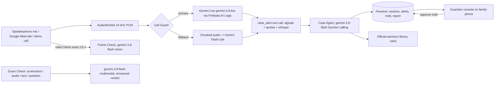

# Second Opinion

**A live scam guardian for the people we love.** Second Opinion listens to a suspicious call (speakerphone or a shared Google Meet tab), recognises the *coercion pattern* of scams such as the fake-police "digital arrest", warns the person calmly in English or Hindi, brings in a family guardian, requests a cool-off hold and drafts the cybercrime complaint, before the money moves.

Built for the **AI Builder Cup 2026** (Google Cloud JAPAC). Theme: *Sustainability & Social Impact*. Problem category: *Social Good*.

- Core user: **senior citizens** (65+).
- Same engine, different audience profile: **teens, young adults, workers** (see the Roadmap page).
- Also: **Scam Check**, where you upload a screenshot or an audio recording, paste a message, or ask a question to find out whether it is a scam.

## Why it matters

| | |
|---|---|
| Japan 2025 | ¥142.3B lost to special fraud (+98%); fake-police scams ¥100.5B; people 65+ bore 59.2% of losses |
| India 2024 | ₹1,935 crore lost to "digital arrest" scams across 1.23 lakh complaints |
| India 2025 | ₹22,495 crore total cyber-fraud losses; investment scams >75% |
| Australia 2025 | A$2.18B lost; people 65+ are 17.1% of the population but 26.5% of losses |
| Singapore 2025 | S$913M lost; only ~S$140M recovered, so prevention beats recovery |

Sources and the avoidable-loss calculator are on the in-app **Impact** page (`shared/stats.json`).

## Architecture



Everything runs on the **Firebase free (Spark) plan**: Hosting, Anonymous Auth, Firestore, App Check, and Gemini through **Firebase AI Logic**. There is no server: the browser talks to Gemini through Firebase AI Logic (App Check protected).

### Gemini features used
Live API (streaming audio, input transcription, tool calling, context-window compression) · function calling (Case Agent) · structured JSON output (verdicts, frame cues, chunk classifier) · multimodal input (images, audio) · multi-speaker TTS (demo calls and whispers, rendered offline) · system-instruction prompt library shared between the app and the evaluation harness.

### Trust & safety
- Every signal is shown with the **exact quote** that triggered it.
- Advice comes from a curated **official-advisory library** with links (I4C, RBI, Sanchar Saathi), not from the model's memory.
- The guardian **approves** any hold; nothing is filed automatically.
- **No raw audio or video is stored**; only risk level, signal names, short quotes and the complaint draft.
- Genuine calls are in the evaluation set, so false alarms are measured too.
- Frame Check reports visual *cues* (uniform, fake warrant), never a deepfake verdict.

## Evaluation

`python tools/run_eval.py` runs 16 scripted calls (10 scam incl. 2 Japanese, 6 genuine) through the **same classifier prompt the app ships** (`shared/prompts.json`). See [`eval/results.md`](eval/results.md). These are scripted, small-scale and indicative, not a field trial.

## Run it

```bash
cd web
cp .env.local.example .env.local   # fill in your Firebase web config
npm install
npm run dev
```

Firebase setup (free Spark plan): create/open the project, add a Web app, enable **Authentication → Anonymous**, **Firestore**, **AI Logic → Gemini Developer API**, and App Check (reCAPTCHA v3). Then:

```bash
firebase deploy --only firestore:rules,hosting
```

Local tools (use a `.env` with `Gemini_key=...` one folder above the repo; it is never committed):

```bash
pip install -r tools/requirements.txt
python tools/render_calls.py --whispers   # demo calls + whisper clips (TTS)
python tools/make_replay.py               # recorded replays
python tools/run_eval.py                  # evaluation table
```

## Demo script

1. Open **Call Guard**, pick the *Digital arrest* demo or share a Google Meet tab where a teammate role-plays the "officer".
2. Watch signals stack up, hear the whisper, see the guardian's phone (`/guardian/CODE`) receive the alert and approve the hold.
3. Open the complaint draft (1930 / cybercrime.gov.in).
4. Play the *Genuine bank callback*: nothing triggers.
5. **Scam Check:** upload a screenshot or audio clip; switch the profile to Teen and check a sextortion DM.

## Repo layout

```
shared/   prompts, scam taxonomy, advisories, helplines, stats (used by the app and the Python tools)
web/      React + Vite + TypeScript + Tailwind app
tools/    TTS rendering, replay builder, evaluation harness
eval/     scripted calls and results
```

*Second Opinion gives guidance, not legal or financial advice.*
